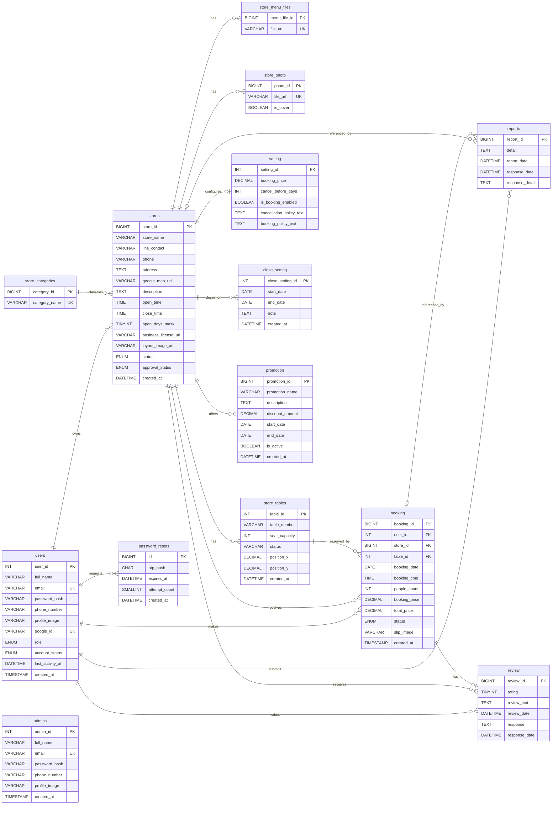

# ER Diagram และโครงสร้างตารางล่าสุด

เอกสารนี้อ้างอิงโครงสร้างฐานข้อมูลจริงหลังใช้ migration `033_match_booking_columns.sql`
โดยรวม 15 ตาราง (รวม `schema_migrations`)

## 1. ER Diagram แบบโยงเส้น

แผนภาพส่วนนี้ใช้เส้นแสดงความสัมพันธ์ และแสดงคอลัมน์ของ `booking` ให้ครบตามแบบ 12 คอลัมน์
รายละเอียด Foreign Key ทั้งหมดอยู่ในหัวข้อที่ 2

> `admins` ไม่มี Foreign Key เชื่อมกับตารางอื่นใน schema ปัจจุบัน จึงแสดงเป็นตารางอิสระ
> `booking` เชื่อมกับ `store_tables` ด้วย `table_id` โดยตรง

## 2. ตารางโครงสร้างที่รวม Foreign Key

สัญลักษณ์: `PK` = Primary Key, `FK` = Foreign Key, `UK` = Unique Key และ `—` = ไม่มี Key

### users

| Column | Type | Null | Key | Reference |
|---|---|---:|---|---|
| user_id | INT | ไม่ได้ | PK | — |
| full_name | VARCHAR(150) | ไม่ได้ | — | — |
| email | VARCHAR(191) | ไม่ได้ | UK | — |
| password_hash | VARCHAR(255) | ได้ | — | — |
| phone_number | VARCHAR(20) | ได้ | — | — |
| profile_image | VARCHAR(500) | ได้ | — | — |
| google_id | VARCHAR(255) | ได้ | UK | — |
| role | ENUM('member','owner') | ไม่ได้ | — | — |
| account_status | ENUM('ACTIVE','SUSPENDED') | ไม่ได้ | — | — |
| last_activity_at | DATETIME(3) | ได้ | — | — |
| created_at | TIMESTAMP | ไม่ได้ | — | — |

### admins

| Column | Type | Null | Key | Reference |
|---|---|---:|---|---|
| admin_id | INT | ไม่ได้ | PK | — |
| full_name | VARCHAR(150) | ไม่ได้ | — | — |
| email | VARCHAR(191) | ไม่ได้ | UK | — |
| password_hash | VARCHAR(255) | ไม่ได้ | — | — |
| phone_number | VARCHAR(20) | ได้ | — | — |
| profile_image | VARCHAR(500) | ได้ | — | — |
| created_at | TIMESTAMP | ไม่ได้ | — | — |

### password_resets

| Column | Type | Null | Key | Reference |
|---|---|---:|---|---|
| id | BIGINT UNSIGNED | ไม่ได้ | PK | — |
| user_id | INT | ไม่ได้ | FK | users.user_id |
| otp_hash | CHAR(64) | ไม่ได้ | — | — |
| expires_at | DATETIME(3) | ไม่ได้ | — | — |
| attempt_count | SMALLINT UNSIGNED | ไม่ได้ | — | — |
| created_at | DATETIME(3) | ไม่ได้ | — | — |

### store_categories

| Column | Type | Null | Key | Reference |
|---|---|---:|---|---|
| category_id | BIGINT UNSIGNED | ไม่ได้ | PK | — |
| category_name | VARCHAR(100) | ไม่ได้ | UK | — |

### stores

| Column | Type | Null | Key | Reference |
|---|---|---:|---|---|
| store_id | BIGINT UNSIGNED | ไม่ได้ | PK | — |
| owner_user_id | INT | ไม่ได้ | FK | users.user_id |
| category_id | BIGINT UNSIGNED | ไม่ได้ | FK | store_categories.category_id |
| store_name | VARCHAR(180) | ไม่ได้ | — | — |
| line_contact | VARCHAR(500) | ไม่ได้ | — | — |
| phone | VARCHAR(20) | ไม่ได้ | — | — |
| address | TEXT | ไม่ได้ | — | — |
| google_map_url | VARCHAR(2048) | ไม่ได้ | — | — |
| description | TEXT | ได้ | — | — |
| open_time | TIME | ไม่ได้ | — | — |
| close_time | TIME | ไม่ได้ | — | — |
| open_days_mask | TINYINT UNSIGNED | ไม่ได้ | — | — |
| business_license_url | VARCHAR(500) | ไม่ได้ | — | — |
| layout_image_url | VARCHAR(500) | ได้ | — | — |
| status | ENUM('PENDING','OPEN','CLOSED','REJECTED','SUSPENDED') | ไม่ได้ | — | — |
| approval_status | ENUM('PENDING','APPROVED','REJECTED') | ไม่ได้ | — | — |
| created_at | DATETIME(3) | ไม่ได้ | — | — |

### store_menu_files

| Column | Type | Null | Key | Reference |
|---|---|---:|---|---|
| menu_file_id | BIGINT UNSIGNED | ไม่ได้ | PK | — |
| store_id | BIGINT UNSIGNED | ไม่ได้ | FK | stores.store_id |
| file_url | VARCHAR(500) | ไม่ได้ | UK | — |

### store_photo

| Column | Type | Null | Key | Reference |
|---|---|---:|---|---|
| photo_id | BIGINT UNSIGNED | ไม่ได้ | PK | — |
| store_id | BIGINT UNSIGNED | ไม่ได้ | FK | stores.store_id |
| file_url | VARCHAR(500) | ไม่ได้ | UK | — |
| is_cover | TINYINT(1) | ไม่ได้ | — | — |

### store_tables

| Column | Type | Null | Key | Reference |
|---|---|---:|---|---|
| table_id | INT | ไม่ได้ | PK | — |
| store_id | BIGINT UNSIGNED | ไม่ได้ | FK | stores.store_id |
| table_number | VARCHAR(20) | ไม่ได้ | — | — |
| seat_capacity | INT | ไม่ได้ | — | — |
| status | VARCHAR(20) | ไม่ได้ | — | — |
| position_x | DECIMAL(6,3) | ได้ | — | — |
| position_y | DECIMAL(6,3) | ได้ | — | — |
| created_at | DATETIME | ไม่ได้ | — | — |

### setting

| Column | Type | Null | Key | Reference |
|---|---|---:|---|---|
| setting_id | INT | ไม่ได้ | PK | — |
| store_id | BIGINT UNSIGNED | ไม่ได้ | FK, UK | stores.store_id |
| booking_price | DECIMAL(10,2) | ไม่ได้ | — | — |
| cancel_before_days | INT | ไม่ได้ | — | — |
| is_booking_enabled | TINYINT(1) | ไม่ได้ | — | — |
| cancellation_policy_text | TEXT | ได้ | — | — |
| booking_policy_text | TEXT | ได้ | — | — |

### close_setting

| Column | Type | Null | Key | Reference |
|---|---|---:|---|---|
| close_setting_id | INT | ไม่ได้ | PK | — |
| store_id | BIGINT UNSIGNED | ไม่ได้ | FK | stores.store_id |
| start_date | DATE | ไม่ได้ | — | — |
| end_date | DATE | ไม่ได้ | — | — |
| note | TEXT | ได้ | — | — |
| created_at | DATETIME | ไม่ได้ | — | — |

### promotion

| Column | Type | Null | Key | Reference |
|---|---|---:|---|---|
| promotion_id | BIGINT UNSIGNED | ไม่ได้ | PK | — |
| store_id | BIGINT UNSIGNED | ไม่ได้ | FK | stores.store_id |
| promotion_name | VARCHAR(255) | ไม่ได้ | — | — |
| description | TEXT | ได้ | — | — |
| discount_amount | DECIMAL(10,2) | ไม่ได้ | — | — |
| start_date | DATE | ไม่ได้ | — | — |
| end_date | DATE | ไม่ได้ | — | — |
| is_active | TINYINT(1) | ไม่ได้ | — | — |
| created_at | DATETIME | ไม่ได้ | — | — |

### booking

| Column | Type | Null | Key | Reference |
|---|---|---:|---|---|
| booking_id | BIGINT UNSIGNED | ไม่ได้ | PK | — |
| user_id | INT | ไม่ได้ | FK | users.user_id |
| store_id | BIGINT UNSIGNED | ไม่ได้ | FK | stores.store_id |
| table_id | INT | ได้ | FK | store_tables.table_id |
| booking_date | DATE | ไม่ได้ | — | — |
| booking_time | TIME | ไม่ได้ | — | — |
| people_count | INT | ไม่ได้ | — | — |
| booking_price | DECIMAL(10,2) | ไม่ได้ | — | — |
| total_price | DECIMAL(10,2) | ไม่ได้ | — | — |
| status | ENUM('PENDING','CONFIRMED','CANCELLED','COMPLETED','NO_SHOW') | ไม่ได้ | — | — |
| slip_image | VARCHAR(255) | ได้ | — | — |
| created_at | TIMESTAMP | ไม่ได้ | — | — |

### reports

| Column | Type | Null | Key | Reference |
|---|---|---:|---|---|
| report_id | BIGINT UNSIGNED | ไม่ได้ | PK | — |
| user_id | INT | ไม่ได้ | FK | users.user_id |
| store_id | BIGINT UNSIGNED | ได้ | FK | stores.store_id |
| booking_id | BIGINT UNSIGNED | ได้ | FK | booking.booking_id |
| detail | TEXT | ไม่ได้ | — | — |
| report_date | DATETIME | ไม่ได้ | — | — |
| response_date | DATETIME | ได้ | — | — |
| response_detail | TEXT | ได้ | — | — |

### review

| Column | Type | Null | Key | Reference |
|---|---|---:|---|---|
| review_id | BIGINT UNSIGNED | ไม่ได้ | PK | — |
| booking_id | BIGINT UNSIGNED | ไม่ได้ | FK, UK | booking.booking_id |
| user_id | INT | ไม่ได้ | FK | users.user_id |
| store_id | BIGINT UNSIGNED | ไม่ได้ | FK | stores.store_id |
| rating | TINYINT UNSIGNED | ไม่ได้ | — | — |
| review_text | TEXT | ได้ | — | — |
| review_date | DATETIME | ไม่ได้ | — | — |
| response | TEXT | ได้ | — | — |
| response_date | DATETIME | ได้ | — | — |

## 3. สรุป Foreign Key และเงื่อนไขการลบ

| Child table | Foreign Key | Parent table | ON DELETE |
|---|---|---|---|
| stores | owner_user_id | users.user_id | RESTRICT |
| stores | category_id | store_categories.category_id | RESTRICT |
| password_resets | user_id | users.user_id | CASCADE |
| store_menu_files | store_id | stores.store_id | CASCADE |
| store_photo | store_id | stores.store_id | CASCADE |
| store_tables | store_id | stores.store_id | CASCADE |
| setting | store_id | stores.store_id | CASCADE |
| close_setting | store_id | stores.store_id | CASCADE |
| promotion | store_id | stores.store_id | CASCADE |
| booking | user_id | users.user_id | CASCADE |
| booking | store_id | stores.store_id | CASCADE |
| booking | table_id | store_tables.table_id | RESTRICT |
| reports | user_id | users.user_id | CASCADE |
| reports | store_id | stores.store_id | SET NULL |
| reports | booking_id | booking.booking_id | SET NULL |
| review | booking_id | booking.booking_id | CASCADE |
| review | user_id | users.user_id | CASCADE |
| review | store_id | stores.store_id | CASCADE |

รวมทั้งหมด 18 Foreign Keys และไม่มีการสร้างหรือแก้ไขตารางฐานข้อมูลจากเอกสารนี้
